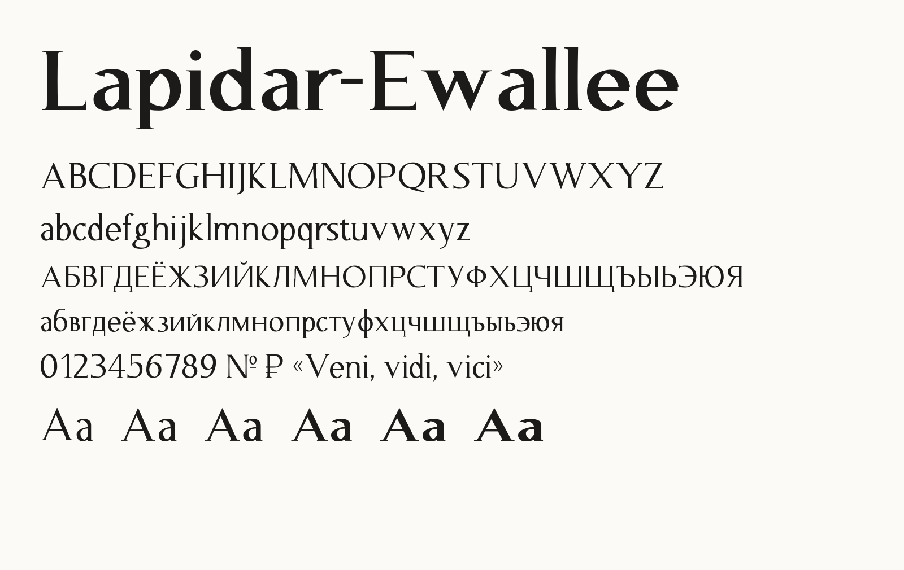
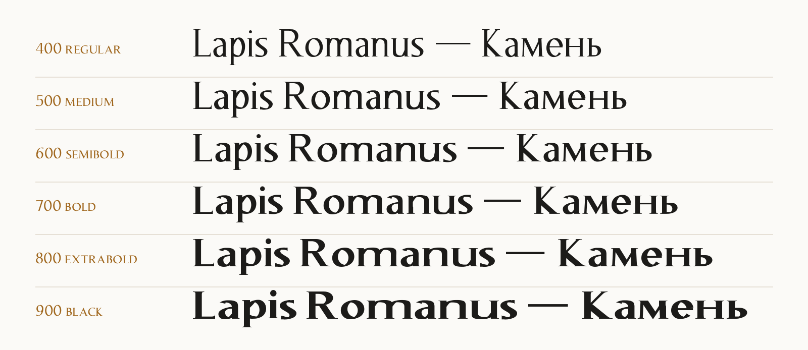
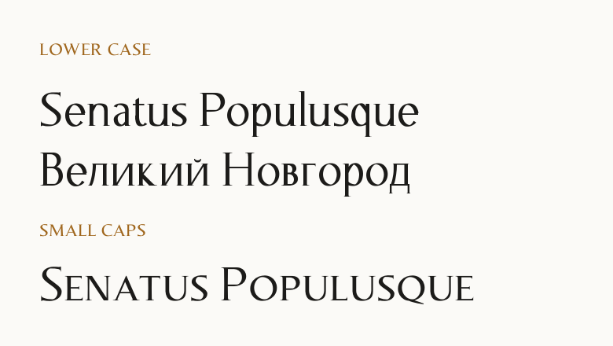
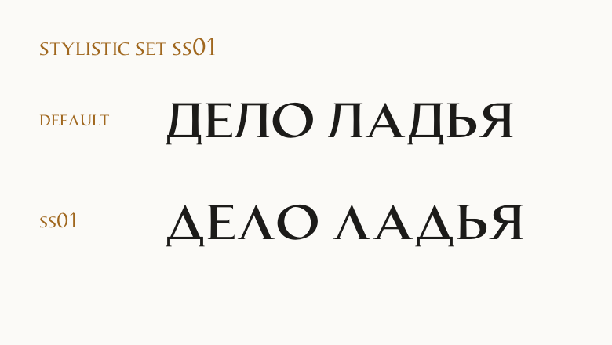

# Lapidar-Ewallee

[](LICENSE)


<a href="https://github.com/Ewallee/lapidar-ewallee-font/raw/main/LapidarEwallee.zip"></a>

A display serif in the spirit of Roman inscriptional capitals, for Latin and Cyrillic.

Wedge serifs, slightly waisted stems and contrast with an inclined axis, like letters cut
in stone. Upper and lower case, plus small caps for headings in the inscriptional manner.



## What's inside

- **Latin and Cyrillic.** Upper and lower case, A–Z, А–Я and Ё, figures, punctuation, № and ₽.
- **Small caps.** OpenType features `smcp` and `c2sc`: lower case or capitals to small capitals.
- **Three weights.** Regular, Bold and Black as separate OTF files.
- **Variable font.** One file with a weight axis from 400 to 900.
- **Alternate Д and Л.** Stylistic set `ss01` switches to triangular forms, in every case.
- **Kerning.** Pairs like AV, LT, ТА and УА are kerned.
- **Web fonts.** WOFF2 with a ready CSS file.



## Install

1. Download [LapidarEwallee.zip](https://github.com/Ewallee/lapidar-ewallee-font/raw/main/LapidarEwallee.zip) - the button above.
2. Unpack it.
3. Install the fonts: on Windows right-click the files → **Install**, on macOS open them in Font Book.

Install either the three OTF files or the variable font, not both: apps may mix them up.

## Files

| File | |
|---|---|
| `otf/LapidarEwallee-Regular.otf` | Regular, 400 |
| `otf/LapidarEwallee-Bold.otf` | Bold, 700 |
| `otf/LapidarEwallee-Black.otf` | Black, 900 |
| `variable/LapidarEwallee[wght].ttf` | variable, 400–900: Regular, Medium, SemiBold, Bold, ExtraBold, Black |
| `web/` | WOFF2 and CSS for websites |

 

## On the web

```html
<link rel="stylesheet" href="web/lapidar-ewallee.css">
```

```css
h1   { font-family: "Lapidar-Ewallee", serif; font-weight: 700; }
.sc  { font-variant-caps: small-caps; }      /* smcp: lower case to small caps */
.alt { font-feature-settings: "ss01"; }       /* triangular Д and Л */
```

Any weight from 400 to 900 works, for example `font-weight: 650`.

## License

[SIL Open Font License 1.1](LICENSE). Free to use, embed and modify, including in commercial work.
The fonts cannot be sold by themselves, and modified versions must stay under the same license.
Documents, sites and images made with the fonts carry no obligations.
